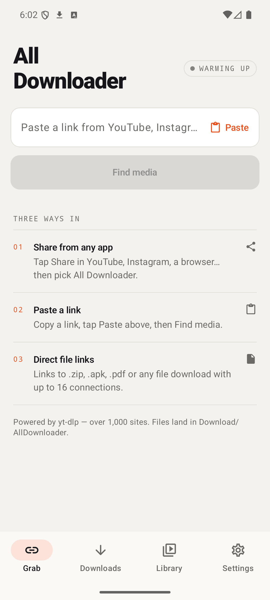
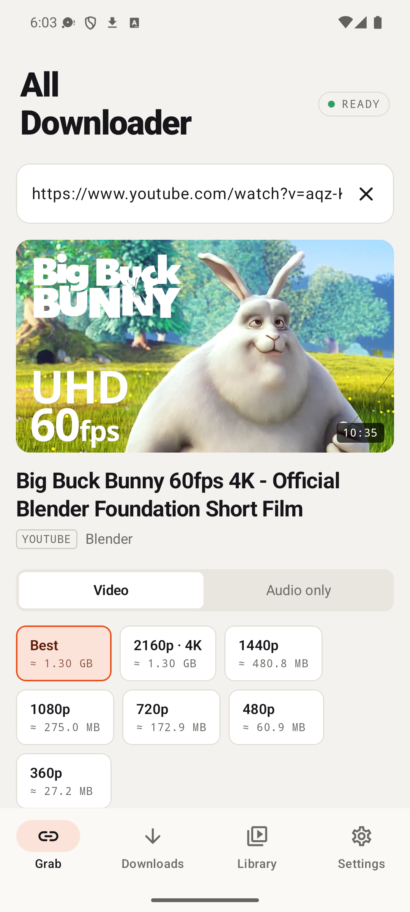
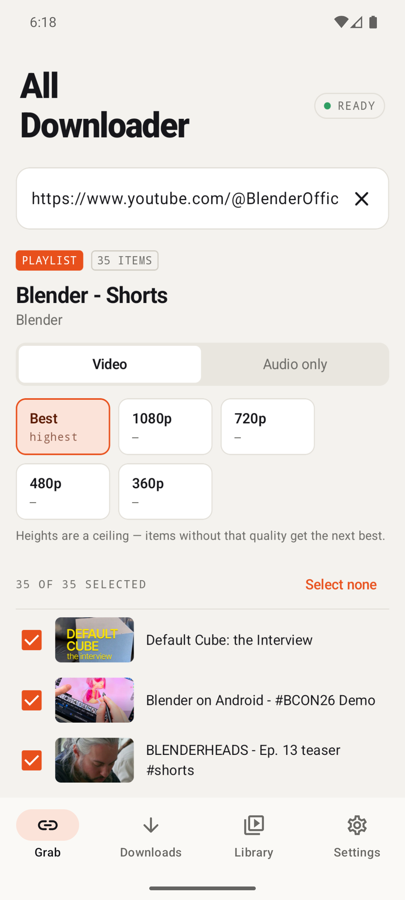
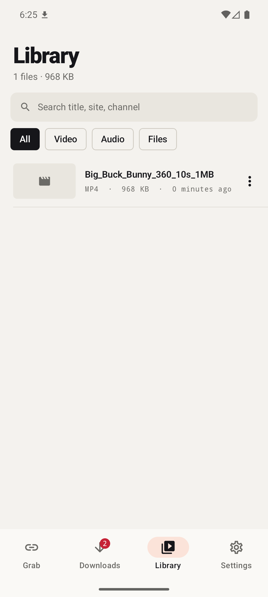
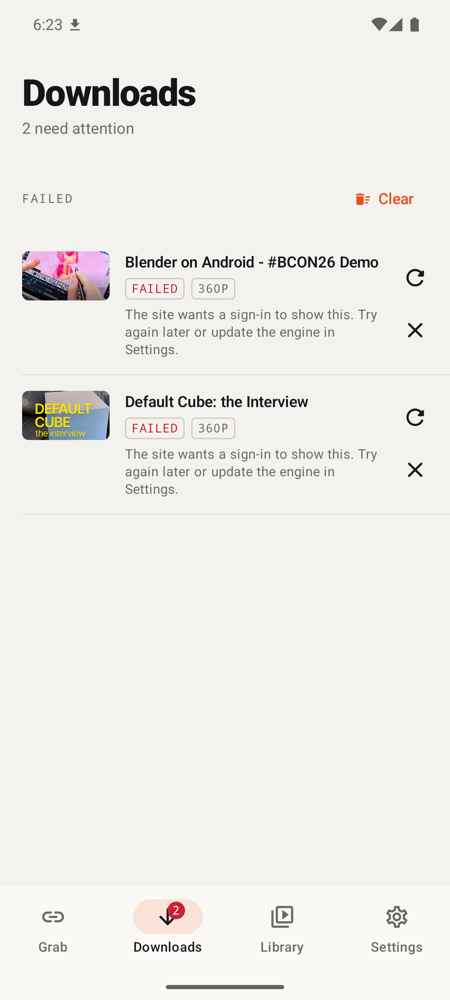
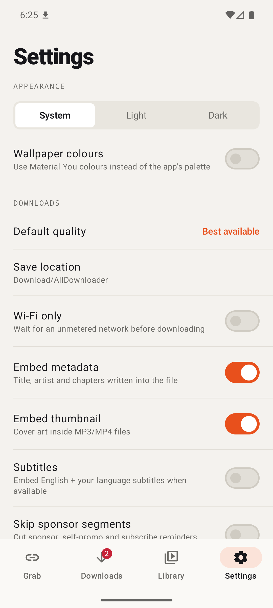
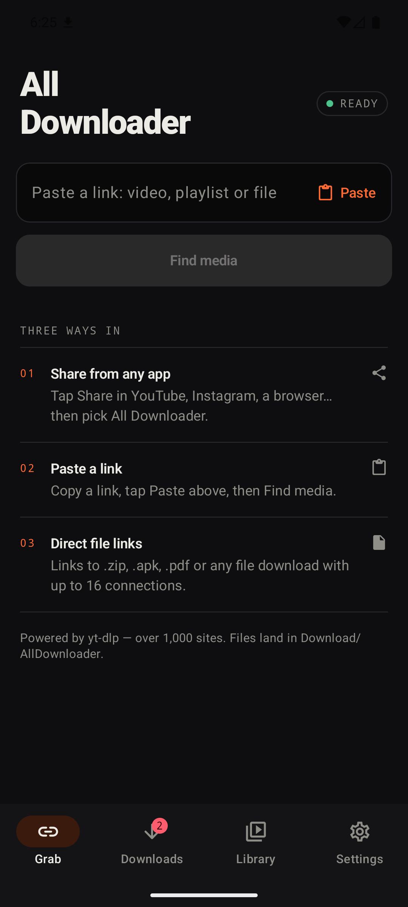

# All Downloader

Download video, audio and files from YouTube, Instagram, X, TikTok, Reddit, Vimeo and 1,000+ other sites — straight to your phone. Powered by [yt-dlp](https://github.com/yt-dlp/yt-dlp), with ffmpeg and aria2c bundled. No ads, no account, no tracking.

<p>
  
  
  
  
</p>
<p>
  
  
  
</p>

## Install

Grab the APK for your phone from the [latest release](https://github.com/anees-dahot/all-downloader/releases/latest):

| File | For |
|---|---|
| `AllDownloader-*-arm64-v8a.apk` | Almost every phone from 2017 on |
| `AllDownloader-*-armeabi-v7a.apk` | Older / budget 32-bit phones |
| `AllDownloader-*-x86_64.apk` | Emulators, Chromebooks |

Not sure? Try `arm64-v8a` first; if Android says the app isn't compatible, use `armeabi-v7a`.

**Requires Android 7.0 or newer.** The app updates itself: when a new release is published here it offers to download and install it.

## Features

- **Share to download** — tap Share in any app and pick All Downloader, or paste a link.
- **Quality picker with sizes** — Best, 4K, 1440p, 1080p, 720p, 480p, 360p, or audio-only MP3 / M4A, with approximate file size for each.
- **Playlists & channels** — paste a playlist or channel tab, tick the items you want, download them in order.
- **Speed booster** — downloads stream fragments over 4, 8 or 16 parallel connections; direct file links use aria2c.
- **Auto-retry & resume** — network drops retry up to 3 times and continue from where they stopped.
- **Queue control** — choose how many downloads run at once, Wi-Fi-only mode, cancel, retry.
- **Library** — search, filter by video / audio / files, open, share, re-download, delete.
- **Extras** — embedded metadata and cover art, subtitles, SponsorBlock segment removal.
- **Always fresh extractors** — the yt-dlp engine updates itself (stable or nightly channel).
- **In-app updates** — new versions from GitHub Releases, matched to your phone's CPU.
- Light / dark / system theme, Material You colours on Android 12+, tablet layout with side rail.

Files are saved to `Download/AllDownloader`.

## Build

```bash
./gradlew assembleRelease
```

Release signing reads `keystore.properties` in the project root (not committed):

```properties
storeFile=release.jks
storePassword=…
keyAlias=alldownloader
keyPassword=…
```

Without it, release builds fall back to the debug key — those can't update a release-signed install.

## Publishing an update

1. Bump `versionCode` and `versionName` in `app/build.gradle.kts`.
2. `./gradlew assembleRelease`
3. Create a GitHub release tagged `vX.Y.Z` and attach the APKs named `AllDownloader-X.Y.Z-<abi>.apk`.

Installed apps pick it up within 12 hours (or immediately via Settings → Check for updates).

## Notes

Only download content you have the right to. YouTube occasionally rate-limits or bot-checks a network; the app falls back to an alternate client automatically, and waiting a few minutes or updating the engine in Settings usually clears it.

## License

MIT
